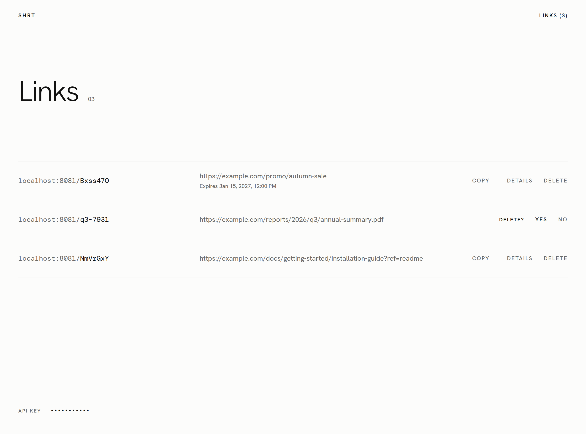
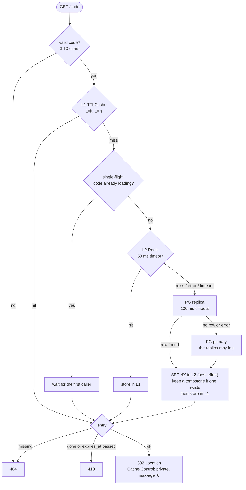
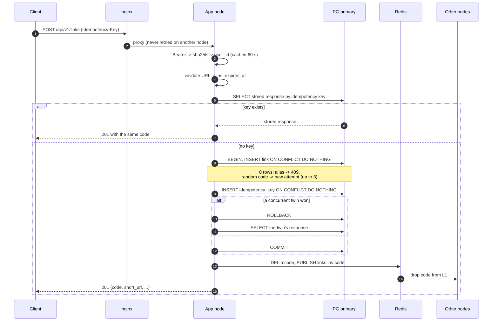
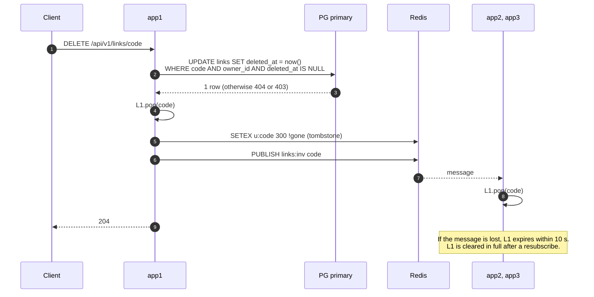
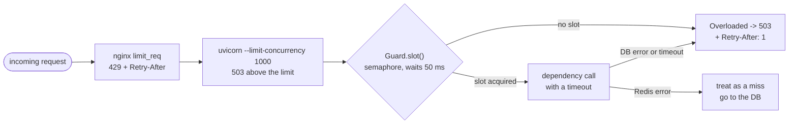
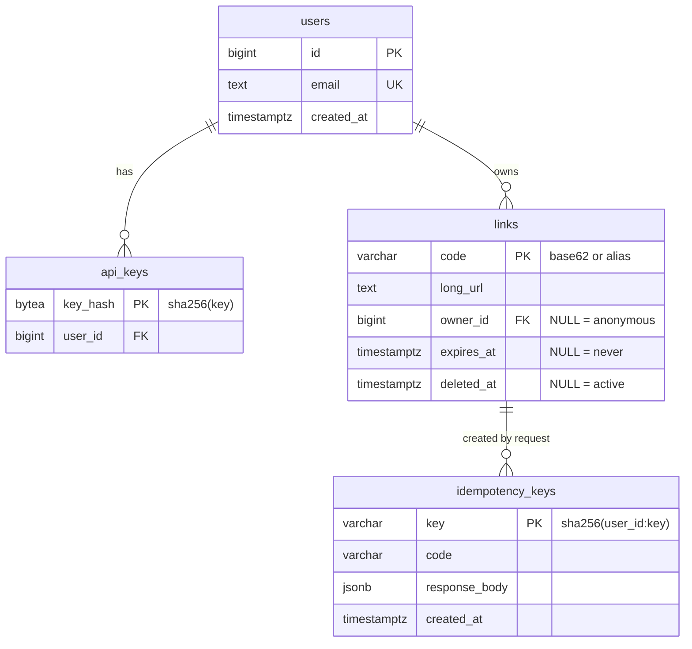
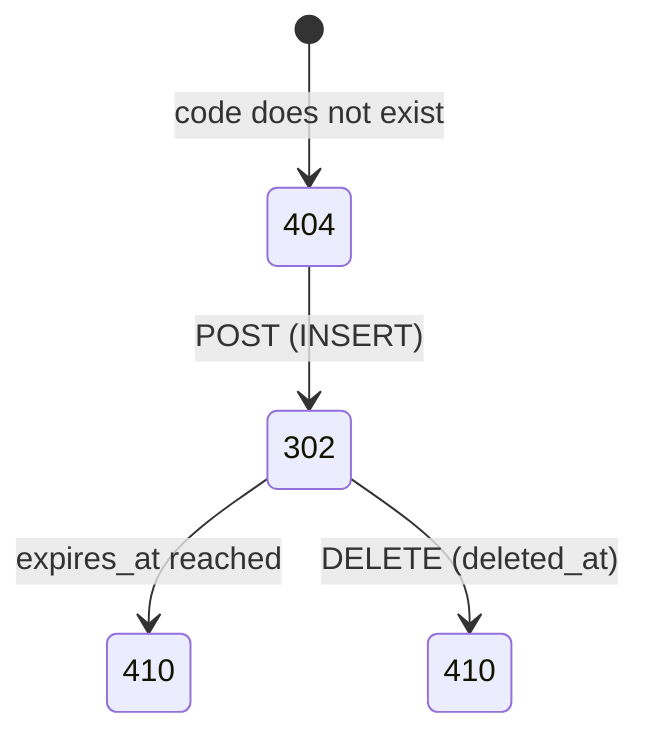

# URL Shortener

Implementation of the SIS #1 design (T1. URL Shortener): API, two-level cache, overload protection, PostgreSQL primary + replica, Redis + Sentinel, and nginx in front of three nodes. Detailed plan (in Russian): [docs/plan.md](docs/plan.md).

## Quick start

```bash
cp .env.example .env     # if port 8080 is taken, change HTTP_PORT and BASE_URL
make up                  # docker compose up -d --build
```

Open the UI at `http://localhost:8080/`. Dev API keys: `dev-key-123` (owner) and `dev-key-456` (another user, for 403 checks).

```bash
curl -s -X POST localhost:8080/api/v1/links \
  -H 'Authorization: Bearer dev-key-123' -H "Idempotency-Key: $(uuidgen)" \
  -H 'Content-Type: application/json' -d '{"long_url":"https://example.com/very/long/path"}'
curl -si localhost:8080/<code> | head -3        # 302 + Location
```

| Command | What it does |
| --- | --- |
| `make test` | unit tests (no Docker needed) |
| `make test-int` | integration tests against a running compose stack |
| `make seed codes load` | 100k links and the k6 load test (700 RPS, 2 min) |
| `make obs` | Prometheus (`:9090`) and Grafana (`:3000`) |
| `make reset` | drop the volumes and initialize the databases again |

Test dependencies: `pip install -r requirements-dev.txt`.

## UI

A single page at `/` with three screens: shorten a link (URL, optional alias and expiry), the list of your links (copy, details, delete with confirmation) and a link detail view (destination, status, created, expires). No build step and no external dependencies: the fonts are embedded. The list and the API key are kept in `localStorage`. Every form submit carries an `Idempotency-Key`, so a double click does not create two links. 429 and 503 responses appear as "Service is busy, retry in N s", based on `Retry-After`.



Styling: light monochrome, Hanken Grotesk and DM Mono, touch targets of at least 44 px, visible focus and `prefers-reduced-motion`.

## Architecture

```mermaid
flowchart LR
    C([Client / browser]) --> N["nginx :80<br/>least_conn, rate limit"]
    N --> A1[app1]
    N --> A2[app2]
    N --> A3[app3]

    subgraph apps [FastAPI nodes]
        A1
        A2
        A3
    end

    A1 & A2 & A3 -.->|"master discovery"| S{{Sentinel}}
    S -.->|monitors| RP
    A1 & A2 & A3 -->|"get/set u:code<br/>pub/sub links:inv"| RP[(Redis primary)]
    RP -. replication .-> RR[(Redis replica)]
    A1 & A2 & A3 -->|"writes, re-check"| PP[(PG primary)]
    A1 & A2 & A3 -->|"redirect reads"| PR[(PG replica)]
    PP -. streaming replication .-> PR
    P[Prometheus] -.->|scrape /metrics| A1 & A2 & A3
```



Each node keeps its own asyncpg pools (primary and replica) and a Redis client that finds the master through Sentinel. Nodes share state only through Redis and the databases, so they can be added or removed without coordination.

## Redirect flow

`GET /{code}` is the hot path. The cache is checked layer by layer, and each layer is slower than the one before.



What this gives:
- 100 parallel requests for a cold code cause one Redis/DB lookup per node (single-flight), so up to 3 across the cluster.
- A Redis failure does not break reads: any Redis error counts as a miss.
- Unknown and deleted codes are cached (`missing` 60 s, `gone` 300 s), so repeated requests for the same bad code do not reach the database.

## Link creation



The `PRIMARY KEY` guarantees code uniqueness, not a prior `SELECT`. The idempotency key is scoped to the user (`sha256(user_id:key)`), so another user's key cannot replay your response.

## Deletion and cache invalidation



Delete writes a tombstone instead of a plain `DEL`. Cache fills use `SET NX`, so a read from a lagging replica cannot put the deleted link back into Redis. If Redis is unreachable when the delete runs, or replica lag exceeds the 300 s tombstone TTL, a stale L2 entry can live until its own TTL (up to about 26 hours).

## Overload protection



Each dependency has its own `Guard`: the database (limit equals the pool size) and Redis (40 concurrent calls). nginx adds `Retry-After: 1` to every 429 and 503.

nginx never ejects a node (`max_fails=0`), because it counts read timeouts as node failures and a busy cluster would be ejected whole. A dead node costs one 100 ms connect, then the GET is retried on another node. `proxy_next_upstream_timeout 150ms` limits retries to failed connects, so slow reads are not retried.

## Data model



`links` and `idempotency_keys` are linked logically by `code`, with no foreign key.

## Link states



## Failure scenarios

| Scenario | Command | Expected |
| --- | --- | --- |
| Node down | `docker compose stop app2` | redirects keep working, nginx retries the GET on another node |
| Redis primary down | `docker compose stop redis-primary` | redirects work through L1 and the DB; Sentinel fails over in about 5 s |
| Redis fully down | stop `redis-primary`, `redis-replica`, `redis-sentinel` | redirects come from the DB, `redis_errors_total` grows |
| PG replica down | `docker compose stop pg-replica` | reads move to the primary, no errors |
| PG primary down | `docker compose stop pg-primary` | redirects keep working, `POST` returns 503 + `Retry-After` |
| Overload | k6 at 3000 RPS | fast 429/503 answers, nodes stay up |

Promoting the replica (`docker compose exec -u postgres pg-replica pg_ctl promote -D /var/lib/postgresql/data`) does not restore writes by itself: `PG_PRIMARY_DSN` still points at `pg-primary`, so it must be changed and the nodes restarted.

## Key decisions

- 302, not 301: browsers do not pin the redirect, so delete and expiry take effect. The cost is that every click reaches the service.
- Random codes, not a counter: codes cannot be walked in order, and no global counter is needed. `PRIMARY KEY` plus a retry resolves collisions.
- Idempotency in the DB, not in the cache: the response is stored in the same transaction as the link, so there is no gap between "created" and "remembered".
- Cache-aside with explicit invalidation and short L1 TTL: tombstones and pub/sub keep the cache correct, and TTLs cover lost messages.
- No Kafka: without click analytics there is no event stream to carry.

## Local vs production

| Local | Production |
| --- | --- |
| nginx without TLS, one instance | TLS at L7, 2+ instances or a cloud LB |
| PG with manual promote | Patroni or managed PG with automatic failover |
| migration through `initdb.d` | alembic or dbmate as a separate job |
| 1 Sentinel, quorum 1 | 3 Sentinels across zones, quorum 2 |
| Redis 256 MB | `maxmemory 6gb` on an 8 GB instance |
| one DB user | separate app (DML), migrator (DDL), replicator roles |
| secrets in `.env` | Vault or Kubernetes Secrets |
| internal networks skip the rate limit | remove `geo $internal` from `nginx.conf` |

## Results

Targets: 700 RPS sustained, p99 < 50 ms, errors < 0.1%. **The targets were not met on the test machine.** The numbers below are measurements, not a capacity limit.

### Test setup

- Server: 6 cores, 24 GB RAM, Docker Compose, 3 app nodes behind nginx, 100k seeded links.
- k6 ran on the same host as the service. The host also runs GitLab, k3s and other services, which used about 2 of the 6 cores while the project was idle (load average about 4).
- Load: k6 `constant-arrival-rate`, 2 minutes per run, skewed code distribution (a small share of links gets most hits).

### Latency and errors

| Target rate | Achieved | Errors | Median | p90 | p95 | Max | Cache |
| --- | --- | --- | --- | --- | --- | --- | --- |
| 700 RPS, run 1 | 537 RPS | 61.6% | 505 ms | 570 ms | 612 ms | 1.13 s | cold |
| 700 RPS, run 2 | 548 RPS | 65.5% | 506 ms | 613 ms | 669 ms | 1.19 s | warm |
| 350 RPS, run 1 | 346 RPS | 0.44% | 12.7 ms | 101 ms | 193 ms | 0.80 s | cold |
| 350 RPS, run 2 | 340 RPS | 1.89% | 17.9 ms | 204 ms | 328 ms | 1.02 s | warm |
| 200 RPS | 200 RPS | 0.18% | 9.5 ms | 54.5 ms | 99.6 ms | 0.79 s | warm |

p99 is not in the table because the k6 summary does not print it. With p95 above 50 ms in every run, the p99 < 50 ms threshold failed in all of them.

### Throughput

- The service served about 540 RPS at most. Above that, requests queue and nginx cuts them at its 500 ms read timeout, so failed requests cluster at 505 ms.
- At 700 RPS, successful requests alone had a median of 244 ms and p95 of 449 ms.
- At 350 and 200 RPS the median stays at 10-18 ms, but a long tail and a small share of errors remain.

### Resource usage during the 700 RPS run

| Container | CPU |
| --- | --- |
| app1 / app2 / app3 | 186% / 189% / 141% |
| k6 | 144% |
| nginx | 55% |
| Redis, Postgres | under 30% |

The three Python nodes are the bottleneck: about 180 RPS per node, with the databases mostly idle. Why each request costs about 10 ms of CPU has not been profiled yet.

### Cache hit split

Measured once, on a laptop with a warm Redis and the code before the review fixes, so it is indicative only: L1 13%, L2 (Redis) 81%, database 6%. It was not measured on the server runs.

### Failure scenarios

Run one at a time on a laptop, 140-650 requests each. `stop app2` was re-checked on the final code.

| Scenario | Result |
| --- | --- |
| Node down (`app2`) | all redirects 302, GET retried on another node |
| Redis primary down | all 302, Sentinel failover completed, invalidation still worked |
| Redis fully down | all 302, `POST` still 201, recovered after restart |
| PG replica down | all 302, `POST` still 201 |
| PG primary down | all 302, `POST` returns 503 with `Retry-After: 1` |
| PG promote | `POST` stays 503 until `PG_PRIMARY_DSN` is changed |

Not tested on the final code: the 3000 RPS overload scenario on the server.

### Tests

27 unit tests and 11 integration tests pass on a fresh stack.

### Known limits

- A node cannot start while the replica is down.
- A deleted link can stay in L2 if Redis is down at delete time or replica lag exceeds 300 s.
- Idempotency cleanup physically deletes expired rows.

## Differences from the plan

- The nginx code regex is quoted: nginx does not start with an unquoted `{3,10}`.
- Redirects use `proxy_read_timeout 500ms` instead of 200 ms, `max_fails=0` instead of 2, and retry only failed connects.
- nginx sets `Retry-After` on all 429 and 503 responses, and `192.168.0.0/16` was added to the internal networks.
- Delete writes a tombstone and cache fills use `SET NX`.
- URLs with control characters or malformed hosts return 400.
- Redis and asyncpg connections are opened at startup, so a burst does not start on an empty pool.
- The idempotency key is stored as `sha256(user_id:key)` so users cannot collide.
- Added `HTTP_PORT` and a second dev user with key `dev-key-456`.
- The `idempotency_keys` cleanup physically deletes rows, as in the plan. This conflicts with the "no DELETE against the database" rule; if that rule applies here, it needs archiving or date partitioning.
- `requirements.lock` was not created, so dependency versions are not pinned.
- k6 tags every request with `name: redirect`, so it no longer creates one metric series per code.
